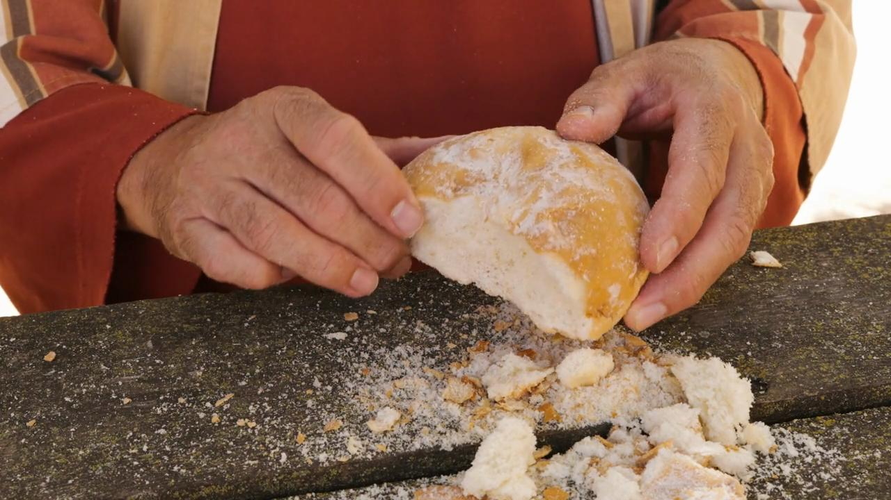

# Familiarization, Internalization, Articulation (FIA) Videos

**Video Bible Dictionary** © 2025 Word Collective. Released under CC BY\-SA 4\.0 license. *Video Bible Dictionary* has been adapted in the following languages: Tok Pisin, عربي, Français, हिंदी, Bahasa Indonesia, Português, Русский, Español, Kiswahili, 简体中文 from *Video Bible Dictionary* © 2025 Word Collective. Released under CC BY\-SA 4\.0 license by Mission Mutual

--------------------------------

## Dry Bread (id: a2577)

### Video Content

 (18 seconds)

[link](https://s3.amazonaws.com/cbbt-er.public/media/videos/a2577/720p.mp4)

* **Associated Passages:** Joshua 9:1-15

